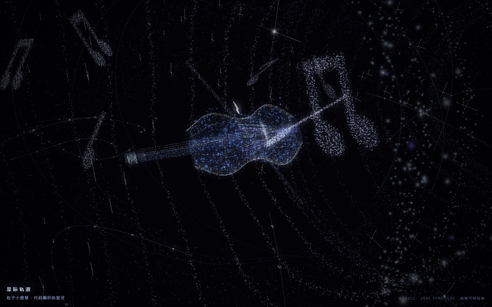

# 星际轨道 · 粒子小提琴 / Interstellar Violin

纯 WebGL2 粒子动画：一把由 14 万个粒子构成的小提琴，悬在星河与星际隧道之间。
**零依赖、零贴图、零构建**——所有几何、材质、镜头都是代码临时算出来的。



## 运行

直接双击 `index.html` 即可（也可以丢到任意静态服务器上）。

```
python -m http.server 8000   # 然后打开 http://localhost:8000
```

## 操作

- 拖拽：转视角
- 滚轮：推拉镜头
- 不加任何操作时，镜头按 24 秒周期走一遍「远观星河 → 贴近看琴 → 穿过隧道」的循环

## 里面有什么

| 部分 | 做法 |
| --- | --- |
| 小提琴 | 13 个半宽控制点插值出琴身轮廓，按体积撒点；fbm 噪声做冰晶质感，f 孔挖空并压暗，另有琴颈、涡卷、指板、琴桥、系弦板、四根琴弦、琴弓 |
| 星河 | 三条对数旋臂 + 内圈星尘，顶点着色器里绕 Y 轴整体自转 |
| 星际隧道 | 34 圈三层同心的粒子线圈，镜头贴近中轴时全亮，侧看时自动压暗 |
| 音符 | 用 canvas 把 ♪ ♫ ♩ 栅格化成点阵再撒成粒子 |
| 轨迹 | 甩出的贝塞尔曲线（带标记点）、环绕轨道弧、四角星芒 |
| 泛光 | 场景先渲到 FBO → 1/4 分辨率阈值提取 → 分离式高斯模糊 → 合成时叠加，并加暗角与颗粒 |

粒子总数约 26 万，单帧 4 次 draw call，移动端 2x DPR 下仍是满帧。

## 文件

```
index.html   页面 + HUD 样式
app.js       全部实现（几何生成、着色器、运镜、泛光）
```

调试参数：`?t=9` 冻结在某一秒，`?view=top` / `?view=side` 固定机位看琴。

## 出处

视觉参考抖音 **@可乐鸡翅^O^** 的 Python 作品（NumPy 手写透视投影 + 粒子，标题「Python 星际轨道」）。
那份源码没有公开，GitHub 上也没有找到对应的开源项目，所以这里按视频逐帧对照重做了一版浏览器实现。

## License

MIT
